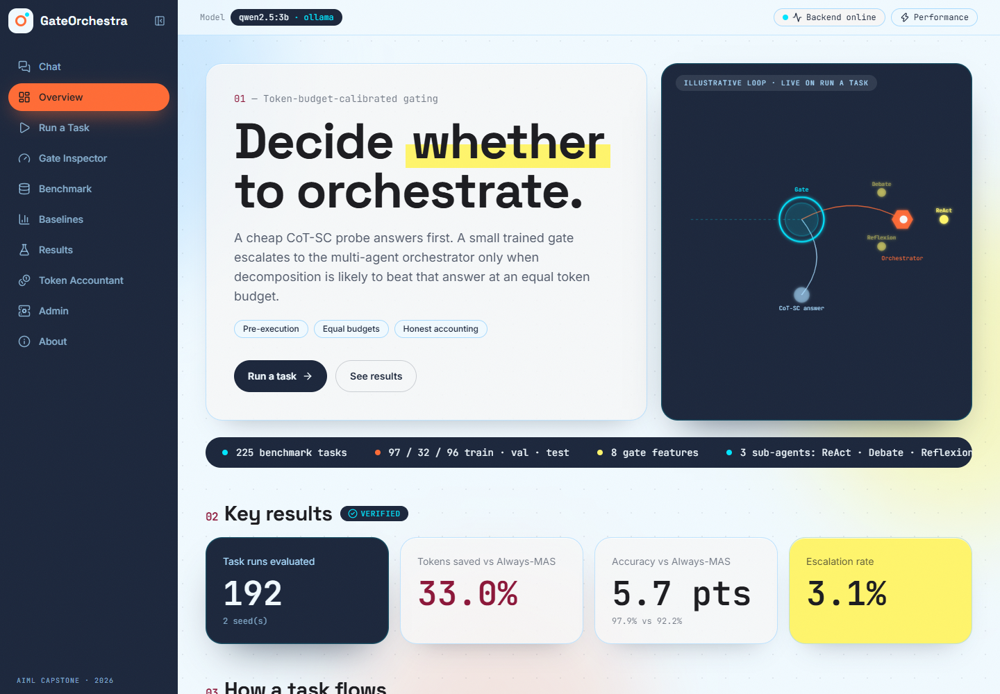
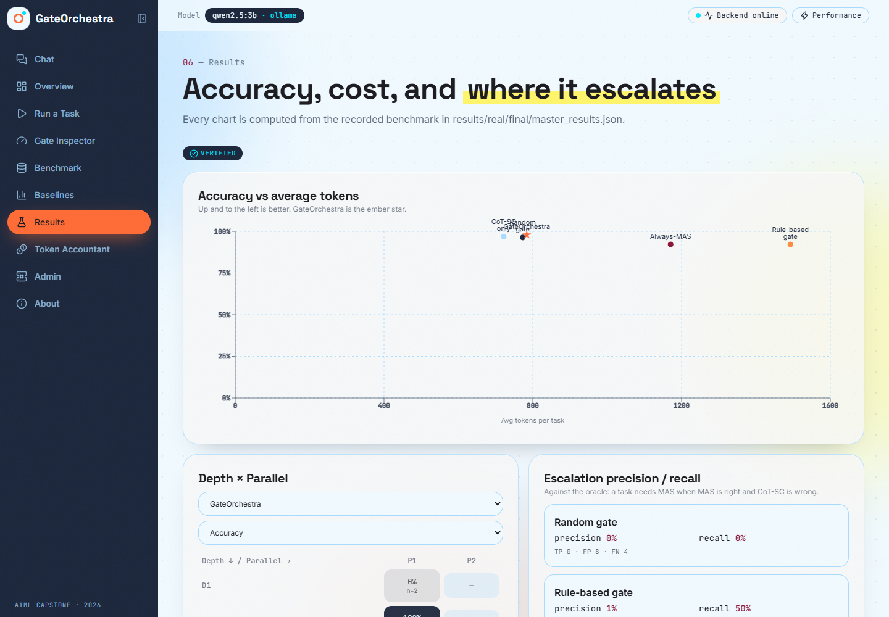
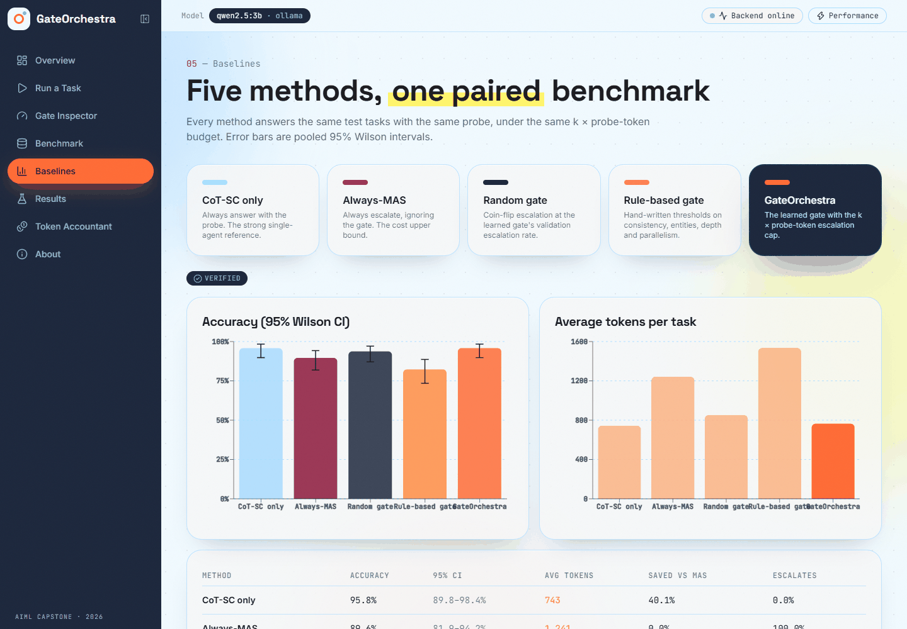
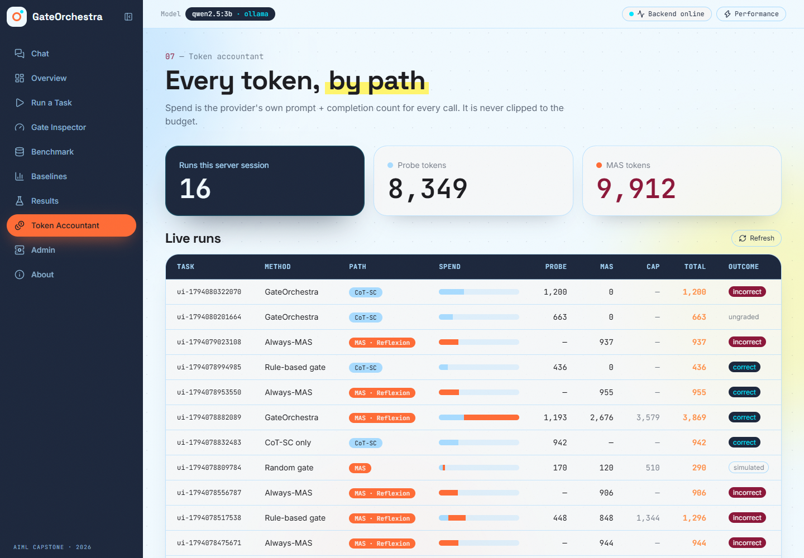

# GateOrchestra

> **Token-Budget-Calibrated Gating Layer for Learned Multi-Agent Orchestration**
> AIML Capstone Project

---

## What It Does

GateOrchestra places a lightweight, trainable **gate** in front of a Multi-Agent System (MAS) orchestrator. Before spending expensive multi-agent compute, the gate decides — using only pre-execution signals — whether to:

- **STOP** → return the inexpensive CoT-SC probe answer (single agent), or
- **ESCALATE** → invoke the full MAS orchestrator, capped at `k × probe_tokens`.

**Research Goal:** ≥40% token savings vs. Always-MAS at ≤2 points accuracy cost, measured under equal token budgets (see the [Blueprint](Blueprint) hypotheses H1/RQ1–RQ3).

**Outcome:** 33% token savings and higher accuracy than Always-MAS on Qwen2.5-3B (97.9% vs 92.2%), but only because MAS was not better than the probe at this scale, so the gate learned to stop. See [Results](#results).

---

## Results

The final benchmark has run and passes `scripts/verify_final_results.py`: Qwen2.5-3B on a local GPU,
96 held-out test tasks x 2 seeds (42, 123), gate and router calibrated on 129 train/validation tasks
run three times each. (An earlier run on the original 32 test tasks, 3 seeds, reached the same conclusions and is archived in `results/real/archive/v1_test32/`.) Full analysis: [`reports/final_analysis.md`](reports/final_analysis.md); write-up:
[`reports/research_report.md`](reports/research_report.md); slides:
[`reports/deck/GateOrchestra_final.pptx`](reports/deck/GateOrchestra_final.pptx).

| Method (test, 2 seeds) | Accuracy | Pooled 95% CI | Avg tokens / task | vs Always-MAS | Escalation |
| :--- | --: | :--- | --: | --: | --: |
| CoT-SC-only | 96.9% | [93.3, 98.6] | 722 | -38.3% | 0% |
| Always-MAS | 92.2% | [87.5, 95.2] | 1,171 | 0% | 100% |
| RandomGate | 96.4% | [92.7, 98.2] | 773 | -34.0% | 4% |
| RuleBasedGate | 92.2% | [87.5, 95.2] | 1,493 | +27.6% | 70% |
| **GateOrchestra** | **97.9%** | [94.8, 99.2] | **784** | **-33.0%** | **3%** |

What it shows:

- **The premise fails on a 3B model.** Over 387 graded calibration runs each, MAS was *less* accurate
  than CoT-SC (80.1% vs 89.1%, sign test p = 0.003) and used 1.25x the tokens. A lenient grader that
  forgives wordy MAS answers narrows the gap to 4.4 points, but MAS is never better.
- **The gate learned the right policy.** It escalated 3% of test tasks, beating Always-MAS by 5.7 points
  at 33% fewer tokens (pooled McNemar p = 0.007, optimistic because the seeds share tasks) and matching
  CoT-SC. The rule-based gate, which escalates 70% of tasks, is significantly worse than CoT-SC (p = 0.004).
- **Little room for any gate.** An oracle would escalate only 2-5% of questions here. Probe consistency is
  the one feature the logistic gate depends on.
- **The test set is near the ceiling.** The 64 tasks added late are easier than the original 32 (CoT-SC scores
  98.4% on them vs 93.8%) and were fact-checked by the assistant, not a second person, so the larger split sharpens the comparison
  less than its size suggests. `dataset/masbench_mini/REVIEW.json` records who reviewed which tasks.

To reproduce: `python scripts/final_benchmark.py` (resumable with `--resume`; `GATE_EVAL_WORKERS=3`
runs three tasks at once against a local Ollama), then `python scripts/verify_final_results.py`,
`python scripts/analyze_final_results.py`, `python scripts/make_figures.py` and
`node reports/deck/build_deck.js`.

The dataset corrections behind these numbers came from an automated audit and still need a person's
review. `python scripts/dataset_review_sheet.py` writes a sign-off sheet locally (it is not published).

### Fixes made before the final benchmark

| Area | Before | Now |
| :--- | :--- | :--- |
| Token accounting | Spend clipped with `min(tokens, budget)`, hiding prompt tokens | True provider totals recorded; budget enforced *before* each call |
| Failed LLM calls | Sub-agents returned a fake answer with 0 tokens; failed probe samples voted with consistency 1.0 | `SubAgentError` / `ProbeError` are raised; failed samples lower consistency |
| Majority vote | Jaccard ≥ 0.5 merged "30 / 60 / 45 square centimeters" | Uses the grader's equivalence (numbers compared by value) |
| Grading | Two graders; "$500" correct for "$5.00", "15" correct for "5" | One grader (`shared/grading.py`) with numeric/unit handling and curated aliases |
| Dataset | 39 tasks wrong, stale or ambiguous (e.g. the U.S. Capitol dome is not gold) | Corrected by `scripts/apply_dataset_corrections.py`; 105 tasks have answer aliases; a local review sheet lists them |
| MAS prompts | Debate/Reflexion dropped the context and previous draft after round 1 | Context and previous draft carried through every step |
| Routing | "auto" router read dataset depth/parallel labels | LinUCB router learned from graded train/val runs, frozen for test; text-only features |
| Budgets | Always-MAS capped at 1,500; escalations at k × probe tokens | Every MAS call capped at k × the paired probe's tokens |
| RandomGate | Fixed 50%; the API rebuilt it per request, so it always stopped | Matched to the learned gate's validation escalation rate; one persistent gate in the API |
| Gate training | Single-class labels → loaded a gate trained on *simulated* data and reported hardcoded metrics | Degenerate constant gate, scored on real validation data and flagged |
| Verifier | Hashed no files; seed and "no mock" checks missing | Checks seeds, dataset SHA-256, per-task records, mock markers, and recomputes aggregates |
| Statistics | Accuracy only | Wilson CIs per method, exact McNemar tests vs CoT-SC-only and Always-MAS |
| API / UI | Mock numbers served as verified; simulator returned the ground truth; dummy-trained gates; fabricated telemetry | Results read from disk with verification status; simulation never sees the answer and is ungraded; UI shows only returned values |

---

## Console

| Overview | Results |
| :---: | :---: |
|  |  |
| **Baselines** | **Token accountant** |
|  |  |

More pages in [`assets/screenshots/`](assets/screenshots/).

---

## Chat assistant

The **Chat** page answers any question: explanations, code, math, facts, and questions about
documents you upload. It runs on Groq by default, falls back to Gemini, and can fall back to a
local Ollama model.

How a message is answered:

1. **Probe:** two short samples in parallel (JSON mode), plus a third only if they disagree. They
   also label the request type; small talk and creative requests skip the gate.
2. **Gate:** in auto mode, the cheapest gate whose rated accuracy is within 2 points of the best.
   Every turn records every gate's verdict and cost, and your 👍/👎 ratings count for every gate
   that would have routed the answer the same way.
3. **STOP** answers directly (the fast model when the probe is confident). **ESCALATE** first runs
   a research agent with tools: Wikipedia search, a calculator, a sandboxed Python runner
   (Docker) and search over your documents.
4. The answer streams back as Markdown with highlighted code and rendered math, plus badges for
   the route, tokens, time and model.

Reliability:

- **Keys and models:** keys rotate. A rate-limited model cools down on its own while other models
  keep working. Over-capacity models fall back to the next one, and a malformed tool call is
  retried without tools.
- **Out of keys:** when every provider is out, the console asks for another Groq or Gemini key.
  The key is checked with the provider, then saved only to your local `.env`.
- **Repeats:** a repeated first question is answered from the cache at zero tokens.
- **Screening:** messages that look like prompt injection are refused using Groq's prompt-guard
  model.

Endpoints: `POST /chat` (server-sent events), `/conversations`, `/documents`,
`/messages/{id}/feedback`, `/assistant/gates`, `/assistant/stats`, `/metrics` (Prometheus) and
`/assistant/status`. The **Admin** page shows usage, tokens, latency, routing, errors and each
key's state; keys are only ever shown by their last four characters.

---

## Production deployment

```bash
cp .env.example .env        # set GROQ_API_KEY, GATE_API_TOKEN and GATE_CORS_ORIGINS
docker compose up --build   # console on http://localhost:8080 (WEB_PORT=8088 if 8080 is taken)
```

The console image (nginx) serves the app and forwards `/api/` to the API container on the same
origin, with buffering off so answers stream. Neither image contains a secret; keys come from
`.env` at run time.

Before exposing the stack publicly:

- **`GATE_API_TOKEN`:** set it. Every endpoint except `/health` then requires
  `Authorization: Bearer <token>`. The console asks for the token once per browser tab and keeps
  it in session storage, never in the bundle.
- **`GATE_CORS_ORIGINS`:** set it to your site instead of `*`.
- **`GATE_RATE_LIMIT_PER_MINUTE`:** chat and upload requests per client per minute; the default
  is 30.
- **`ASSISTANT_PROVIDERS`:** put at least two providers here (for example `groq,gemini`), so one
  provider's outage or rate limit does not stop the chat.
- **Admin endpoints:** adding API keys and clearing the cache are accepted from the host itself,
  with `GATE_API_TOKEN` (the operator's token, once it is set), or with `GATE_ADMIN_TOKEN`.
  Behind the proxy with no token set, nobody can add keys, so set `GATE_API_TOKEN`.
- **Terminate TLS** at your host or a proxy in front of port 8080.
- **Scrape `/metrics`** with Prometheus, or watch the Admin page.

Conversations, ratings, usage, the cache and any key added from the console live in the
`gateorchestra-data` Docker volume (`/app/logs`, with keys in `keys.env`). It is a named volume
rather than a folder of this repo because SQLite needs real file locking, which synced folders
such as Google Drive do not provide. The compose API container has no Docker, so the Python code
sandbox is off there; run the API on the host (`python scripts/dev.py`) to use it. CI runs the Python and console tests, a browser smoke test
against the offline mock provider, and both Docker builds.

---

## Architecture

```text
Task
 │
 ▼
[Probe Agent]  ──── CoT-SC (3 samples) ────► ProbeResult
 │                                          (consistency_score, tokens_used)
 ▼
[Feature Extractor]  ────► GateFeatures (8 features, question + context)
 │
 ▼
[Gate]  ────► GateDecision (STOP | ESCALATE)
 │
 ├── STOP     ────► return probe answer                       ──┐
 │                                                             ├──► EvalResult ───► TokenAccountant
 └── ESCALATE ────► [MAS Orchestrator: ReAct | Debate | Reflexion] ──┘
                   (budget = k × probe_tokens, true spend recorded)
```

The gate is one of: the calibrated learned gate (logistic regression, GBT or MLP, selected on validation over τ_acc ∈ {0.03, 0.05, 0.08} and k ∈ {2, 3, 5}), the rule-based gate, or the random gate. Escalated tasks are routed by a text-only heuristic (comparisons → Debate, context or deep tasks → ReAct, otherwise Reflexion); a LinUCB bandit router is available with `MASOrchestrator(default_strategy="bandit")` but is not used in the benchmark.

---

## Repo Structure

```text
gateorchestra/
├── shared/          # Contract layer: schemas, config, grading, token accounting, data loading
├── dataset/         # MASBench-mini (225 tasks: 97/32/96), aliases, cleaning, validation, leakage audit
├── agents/          # Probe agent, sub-agents (ReAct, Debate, Reflexion), orchestrator, Groq/Ollama providers
├── gate/            # Classifiers (LogReg, GBT, MLP, Constant), rule-based gate, random gate, features
├── evaluation/      # Metrics, Wilson CIs, exact McNemar test
├── integration/     # Pipeline wiring Probe → Gate → MAS
├── api/             # FastAPI backend (/run, /tasks, /models, /history, /demo/summary)
├── frontend-react/  # React + TypeScript console with three.js scenes (see frontend-react/README.md)
├── tests/           # pytest suite (network calls blocked; see tests/conftest.py)
├── scripts/         # Final benchmark, verifier, dataset tools; weekN_* scripts are the simulated dev pipeline
├── results/         # real/final (benchmark output), simulated/ (simulation only)
└── configs/         # default.yaml (mirror of shared/config.py) and trained gates (configs/models/)
```

---

## Quickstart

### 1. Installation
```bash
git clone https://github.com/FarhanAaqil/GateOrchestra.git
cd GateOrchestra
pip install -e ".[dev]"
python -m spacy download en_core_web_sm
```

### 2. Tests and checks
```bash
pytest --cov=shared --cov=gate --cov=integration --cov=agents --cov=evaluation --cov=api --cov=dataset --cov-fail-under=80
ruff check . && black --check . && mypy shared/ gate/ integration/

# Console (Node 22+)
cd frontend-react && npm ci && npm run lint && npm run typecheck && npm test && npm run build
```
The Python suite never calls a real LLM, and one test fails if a credential
is committed. CI runs all of the above on every push.

### 3. Web application
```bash
python scripts/dev.py
```
This starts the API on the first free port from 8010 and the console on
[http://localhost:5173](http://localhost:5173), already pointed at that API, so
another app on port 8000 can never be mistaken for GateOrchestra. When the
repo lives in a synced folder (Google Drive, OneDrive, Dropbox), where npm
installs fail, the console is mirrored to `~/.gateorchestra-build` and run
from there. Ctrl+C stops both. `python scripts/dev.py --dry-run` prints the
plan, and `--api-port` / `--ui-port` override the ports.

To run the pieces yourself: `uvicorn api.main:app --port 8010`, then
`npm run dev` in `frontend-react` with `VITE_API_BASE_URL=http://127.0.0.1:8010`
in `frontend-react/.env.local`.

`GateOrchestra` needs a trained gate in `configs/models/` (written by the final
benchmark); without one the API returns HTTP 503. Simulated runs
(`force_simulation: true`) show routing only and are returned ungraded. The
API keeps the last 50 runs in `logs/api_history.jsonl`.

### Credentials
Keep API keys in `.env` (gitignored) and GitHub tokens in the git credential
manager, never in a remote URL: `git remote get-url origin` should print a URL
with no token in it.

---

## Final Benchmark

```bash
# 1. Full benchmark: 96 test tasks × seeds 42, 123 (real LLM calls; long-running, resumable)
python scripts/final_benchmark.py            # add --resume to continue after an interruption
python scripts/final_benchmark.py --n 5      # smoke test on a subset

# 2. Verify integrity (dataset hash, seeds, per-task records, no mock data)
python scripts/verify_final_results.py       # --allow-partial accepts a smoke run as PARTIAL

# 3. Analyse, draw figures and rebuild the deck (no LLM calls)
python scripts/analyze_final_results.py      # reports/final_analysis.md
python scripts/make_figures.py               # reports/figures/
node reports/deck/build_deck.js              # reports/deck/GateOrchestra_final.pptx

# 4. Audit dataset leakage
python scripts/audit_leakage.py
```
`GATE_EVAL_WORKERS=3` evaluates three tasks at once against a local Ollama, which roughly halves the run.
Later seeds reuse the gate and router calibrated on the first seed (`--calibrate-per-seed` retrains them).
Each seed writes `results/real/final/final_eval_seed_<seed>_n_all.json` with per-method accuracy and Wilson CIs, per-task outcomes, the selected gate (flagged if degenerate), and McNemar tests; `master_results.json` aggregates them.

---

## Hyperparameters

All parameters live in `shared/config.py`; `configs/default.yaml` mirrors them and a test fails if they drift.

| Parameter | Value | Description |
| :--- | :--- | :--- |
| `TAU_ACC` | 0.05 (swept 0.03 / 0.05 / 0.08) | Accuracy gap over repeats needed to label a task ESCALATE |
| `K_DEFAULT` | 3 (swept 2 / 3 / 5) | MAS budget = k × the task's probe tokens |
| `PROBE_TOKEN_BUDGET` | 1000 | Completion tokens for the whole probe, split across samples (333 each) |
| `COT_SC_N_SAMPLES` | 3 | Self-consistency samples per probe |
| `N_REPEATS` | 3 | Repeated train/val runs per task for label stability |

---

## LLM Provider Setup

`shared/config.py` and `.env.example` default to local Ollama with `qwen2.5:3b`,
which fits a 4 GB GPU. The Blueprint names `qwen2.5:7b-instruct`; set
`GATE_MODEL_NAME` to use it, and retrain the gate, because the gate's features
come from the probe model.

### Local Ollama (default)
```bash
ollama serve
ollama pull qwen2.5:3b
export GATE_LLM_PROVIDER=ollama
export GATE_MODEL_NAME=qwen2.5:3b
export GATE_API_BASE=http://localhost:11434
```

### Groq cloud
```powershell
$env:GROQ_API_KEY = "gsk_your_groq_api_key_here"
$env:GATE_LLM_PROVIDER = "groq"
$env:GROQ_MODEL_NAME = "qwen/qwen3.8-27b"
```
