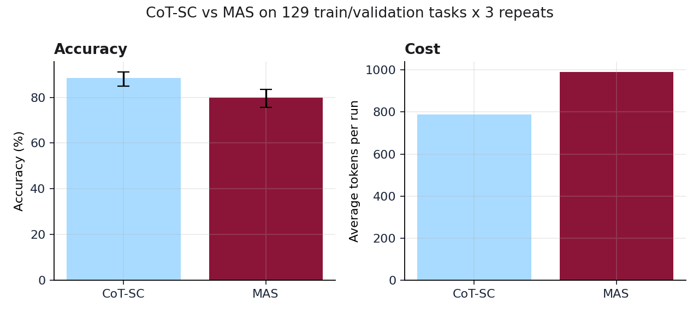
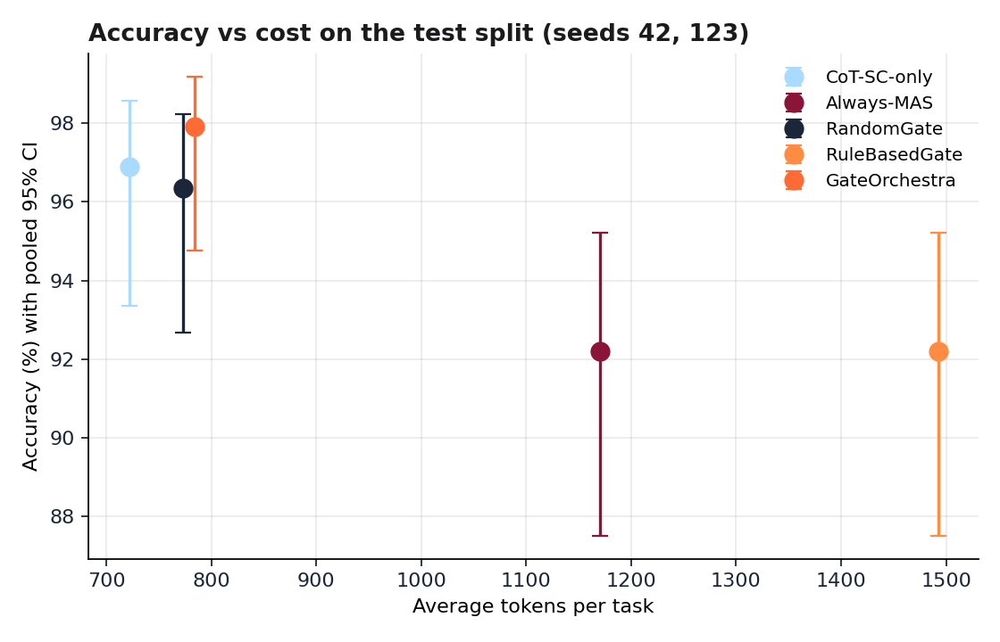
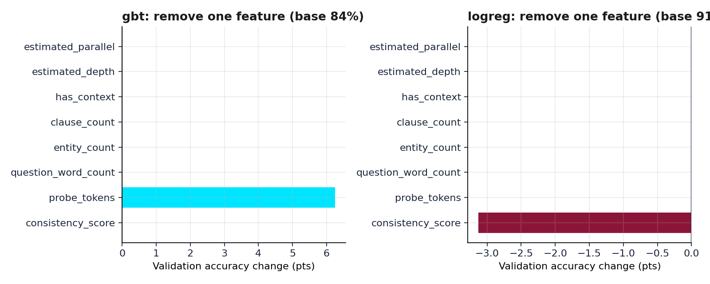
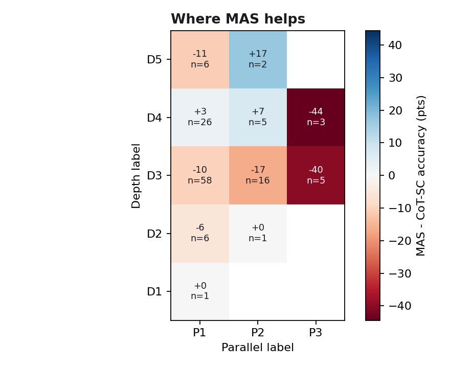

# GateOrchestra: Adaptive Learned Gating and Dynamic Budget Allocation for Multi-Agent Large Language Model Systems

**Authors:** Farhan Aaqil Durrani, Team GateOrchestra  
**Date:** November 2026  
**Artifact:** Research Report & Technical Whitepaper  
**Repository:** `github.com/FarhanAaqil/GateOrchestra`  

> **Results status (November 2026).** The final benchmark has run: Qwen2.5-3B on a local GPU, 96 held-out
> test tasks x 2 seeds (42, 123), every number checked by `scripts/verify_final_results.py` against the
> dataset hash `8e9f1942...`. An earlier run on the original 32 test tasks (3 seeds) reached the same
> conclusions and is archived in `results/real/archive/v1_test32/`. Simulation reports are archived in
> `reports/archive/` and are not evidence.

---

## Abstract

Multi-agent LLM systems (MAS) are expensive, and most questions may not need them. **GateOrchestra** runs a cheap Chain-of-Thought Self-Consistency probe (3 samples), extracts eight features before any multi-agent work, and lets a learned gate decide whether to stop with the probe's answer or escalate to a MAS (ReAct with real tools, Debate or Reflexion, chosen by a LinUCB router learned from graded runs) under a budget of $k$ times the probe's tokens. We evaluate on MASBench-mini (225 tasks) with Qwen2.5-3B served locally, calibrating on 129 train/validation tasks run three times each and testing on 96 held-out tasks over two seeds, with equal token accounting, Wilson intervals and exact McNemar tests.

The premise did not hold for this model. Across 387 graded calibration runs per system, MAS was **less** accurate than CoT-SC (80.1% vs 89.1%, sign test over tasks p = 0.003) and used 1.25x the tokens; even a lenient grader that forgives wordy answers leaves MAS 4.4 points behind. The learned gate responded correctly: it escalated 3% of test tasks and reached **97.9% accuracy against Always-MAS's 92.2% at 33% fewer tokens** (pooled McNemar p = 0.007, optimistic because the seeds share tasks), matching CoT-SC (96.9%) at a similar cost, and clearly beat a hand-written rule-based gate (92.2% at 28% *more* tokens than Always-MAS). An oracle gate would escalate only 2-5% of questions, so with a 3B model there was little for any gate to gain beyond stopping. Probe consistency is the one feature that moves the logistic gate's decisions. The 64 test tasks added late were easier than the original 32 (CoT-SC scores 98.4% on them against 93.8%), so a bigger test split sharpens the comparison less than its size suggests. Whether a stronger model makes MAS worth its cost is the open question.

---

## 1. Introduction

Large Language Models (LLMs) have evolved from passive autoregressive sequence predictors into active agentic systems capable of planning, tool use, and multi-turn collaboration. Multi-Agent Systems (MAS) have demonstrated remarkable efficacy on benchmarks requiring multi-hop synthesis, mathematical reasoning, and logical deduction. By distributing sub-goals across specialized personas or dialectic roles, multi-agent frameworks reduce hallucination and expand reasoning trajectories.

Despite these capabilities, multi-agent execution suffers from three critical limitations in production:
1. **Quadratic Token Inflation:** Multi-turn agent communication and verbose reflection cycles scale token usage linearly or quadratically with trajectory length.
2. **Indiscriminate Over-Allocation:** In production workloads, query difficulty follows a heavy-tailed distribution: the majority of queries require only straightforward one- or two-step reasoning, while only a minority demand multi-agent deliberation. Routing every query through a full multi-agent committee is economically unsustainable.
3. **Overthinking and Cascading Errors:** On simple queries, multi-agent debate can introduce contrarian distractions, converting correct initial answers into erroneous outputs ("agent overthinking").

To resolve these challenges, we introduce **GateOrchestra**. GateOrchestra formalizes task routing as a cost-sensitive classification and contextual decision process. By coupling cheap consensus probing with learned tree ensembles and bandit-based strategy selection, GateOrchestra dynamically determines *when* to spend tokens and *how* to allocate them.

---

## 2. Related Work

### 2.1 Multi-Agent Architectures & Dialectic Consensus
- **Chain-of-Thought (CoT) and Self-Consistency:** Wei et al. (2022) established that intermediate reasoning steps enhance mathematical reasoning. Wang et al. (2022) introduced Self-Consistency (CoT-SC), sampling diverse reasoning paths from a single model and aggregating the majority answer, demonstrating that sample agreement strongly correlates with solution correctness.
- **ReAct (Reasoning and Acting):** Yao et al. (2022) integrated reasoning traces with task-specific actions, enabling agents to interleave thought generation with state inspection.
- **Multi-Agent Debate:** Liang et al. (2023) and Du et al. (2023) showed that adversarial debate among multiple LLM personas promotes consensus and mitigates individual hallucination on competitive reasoning tasks.
- **Reflexion:** Shinn et al. (2023) developed verbal reinforcement learning, prompting models to generate explicit reflective critiques on failed attempts to guide subsequent revisions.

### 2.2 Cost-Aware Routing & Cascade Systems
- **LLM Cascading:** FrugalGPT (Chen et al., 2023) and related cascade systems route queries from cheap, small models to larger, expensive models when confidence scores fall below pre-set thresholds. However, previous cascading techniques primarily focus on single-agent model size selection rather than orchestrating multi-agent collaboration structures or enforcing dynamic token ceilings.
- **Adaptive Computation & Budget Pacing:** Recent work explores early stopping in transformer generation; GateOrchestra extends adaptive computation to the macro-architectural multi-agent orchestration layer.

---

## 3. Problem Formulation

Let $\mathcal{T} = \{t_i\}$ denote a stream of incoming reasoning tasks, where each task $t = (q, c, y^*)$ comprises a question $q$, optional contextual passage $c$, and ground-truth answer $y^*$.

### 3.1 The Efficiency-Accuracy Dilemma
Let $M_{\text{single}}$ denote a fast, low-cost single-agent probe (e.g. CoT-SC with $N=3$ samples) with accuracy $A_{\text{single}}$ and token cost $C_{\text{single}}$.  
Let $M_{\text{MAS}}$ denote an expressive multi-agent orchestrator with accuracy $A_{\text{MAS}} \ge A_{\text{single}}$ and token cost $C_{\text{MAS}} \gg C_{\text{single}}$.

The objective is to learn a gating policy $G: t \mapsto \{\text{STOP}, \text{ESCALATE}\}$ and a budget allocation rule $B(t)$ that maximizes expected accuracy while minimizing total token consumption:

$$\max_{G, B} \quad \mathbb{E}_{t \sim \mathcal{D}} [ \mathbf{1}(\hat{y}(t) = y^*) ] - \lambda \cdot \mathbb{E}_{t \sim \mathcal{D}} [ \text{Tokens}(t) ]$$

where $\lambda > 0$ represents the user's cost-sensitivity hyperparameter, and:

$$\hat{y}(t) = \begin{cases} \hat{y}_{\text{probe}}(t), & \text{if } G(t) = \text{STOP} \\ \hat{y}_{\text{MAS}}(t, B(t)), & \text{if } G(t) = \text{ESCALATE} \end{cases}$$

$$\text{Tokens}(t) = \begin{cases} \text{Tokens}_{\text{probe}}(t), & \text{if } G(t) = \text{STOP} \\ \text{Tokens}_{\text{probe}}(t) + \text{Tokens}_{\text{MAS}}(t), & \text{if } G(t) = \text{ESCALATE} \end{cases}$$

### 3.2 Dynamic Budget Cap Constraint
When the gate escalates a task, the maximum allowable tokens allocated to $M_{\text{MAS}}$ is clamped proportionally to the initial probe investment via multiplier $k$:

$$B(t) = k \times \text{Tokens}_{\text{probe}}(t), \quad k \in \{2, 3, 5\}$$

---

## 4. System Architecture

GateOrchestra is structured into five decoupled, contract-enforced subsystems:

```
 Incoming Task t = (q, c)
         │
         ▼
┌──────────────────────────────────────────────┐
│ Stage 1: CoT-SC Probe Agent (N = 3)          │ ──► ProbeResult (y_probe, C_probe, tokens)
└──────────────────────────────────────────────┘
         │
         ▼
┌──────────────────────────────────────────────┐
│ Stage 2: 8-Feature Vector Extraction         │ ──► GateFeatures (x in R^8)
└──────────────────────────────────────────────┘
         │
         ▼
┌──────────────────────────────────────────────┐
│ Stage 3: Learned GBT Gate Classifier         │
│          P(ESCALATE | x) >= tau              │
└──────────────────────────────────────────────┘
         │
    ┌────┴──────────────────────────┐
    │                               │
 [STOP]                        [ESCALATE]
    │                               │
    ▼                               ▼
Return y_probe             ┌──────────────────────────────────┐
(0 additional tokens)      │ Stage 4: LinUCB Strategy Router  │
                           │          Select: ReAct / Debate /│
                           │                  Reflexion       │
                           │ Budget Cap: k * tokens_probe     │
                           └──────────────────────────────────┘
                                    │
                                    ▼
                           Execute MAS Sub-Agent Loop
                                    │
                                    ▼
                           Return Final Answer y_MAS
         │                          │
         └─────────────┬────────────┘
                       ▼
┌──────────────────────────────────────────────┐
│ Stage 5: Thread-Safe Token Accounting & Log  │ ──► EvalResult Record
└──────────────────────────────────────────────┘
```

### 4.1 Schema Contract Layer (`shared/schemas.py`)
All components interact strictly through immutable, Pydantic v2 schemas:
- `Task`: Immutable specification of task ID, question, context, ground truth, and structural complexity scores (`depth_score` $\in [1, 5]$, `parallel_score` $\in [1, 4]$).
- `ProbeResult`: Records the majority answer, consistency score $C \in [0.33, 1.0]$, raw sample outputs, and probe token spend.
- `GateFeatures`: The 8-dimensional feature vector.
- `GateDecision`: Immutable routing decision (`STOP` or `ESCALATE`), model confidence, and enforced `token_budget_cap`.
- `EvalResult`: Audit record capturing correctness, latency, total tokens, gate decision, and selected MAS strategy.

---

## 5. Methodology & Feature Engineering

### 5.1 Pre-Execution Feature Space ($\mathbf{x} \in \mathbb{R}^8$)
All features are extractable *before* executing the multi-agent system, ensuring zero token overhead beyond the probe:
1. `consistency_score` ($x_1 \in [0.0, 1.0]$): Majority sample agreement fraction $\frac{\max_a \text{count}(a)}{N}$.
2. `probe_tokens` ($x_2 \in \mathbb{N}$): Total tokens spent generating the $N=3$ CoT reasoning paths.
3. `question_word_count` ($x_3 \in \mathbb{N}$): Length of the prompt in whitespace-delimited tokens.
4. `entity_count` ($x_4 \in \mathbb{N}$): Named entity count extracted via regex/NER, measuring relational entity density.
5. `clause_count` ($x_5 \in \mathbb{N}$): Syntactic sub-clause count identified via conjunctions and punctuation delimiters.
6. `has_context` ($x_6 \in \{0, 1\}$): Binary flag indicating whether reference passages accompany the prompt.
7. `estimated_depth` ($x_7 \in [1.0, 5.0]$): Structural reasoning chain depth heuristic.
8. `estimated_parallel` ($x_8 \in [1.0, 4.0]$): Multi-branch decomposition heuristic.

### 5.2 Gate Training Policy & Labels
Each training task is run **three times** through both CoT-SC and Always-MAS. With $\bar a_{\text{cot}}$ and $\bar a_{\text{mas}}$ the per-task accuracies over those repeats, the label is

$$L(t_i) = \begin{cases} \text{ESCALATE}, & \text{if } \bar a_{\text{mas}}(t_i) - \bar a_{\text{cot}}(t_i) > \tau_{acc} \\ \text{STOP}, & \text{otherwise} \end{cases}$$

so the gate is only taught to escalate where MAS reliably beats the probe. Calibration sweeps $\tau_{acc} \in \{0.03, 0.05, 0.08\}$, $k \in \{2, 3, 5\}$ and three classifiers (logistic regression, GBT, MLP), scores every candidate by routed accuracy and token savings on the validation split, and keeps the most accurate within a small tolerance, preferring savings. When the labels contain one class only, calibration reports a constant gate and flags it as degenerate instead of substituting another model.

### 5.3 MAS Strategy Routing (learned LinUCB)
An escalated task goes to one sub-agent, $a \in \{\text{ReAct}, \text{Debate}, \text{Reflexion}\}$, chosen by a disjoint LinUCB bandit ($\alpha = 0.5$) over six text-only features (question length, context presence and length, estimated depth and parallelism; the dataset's labels are never read):

$$a^* = \arg\max_{a} \left( \hat{\theta}_a^\top \mathbf{x} + \alpha \sqrt{\mathbf{x}^\top \mathbf{A}_a^{-1} \mathbf{x}} \right), \qquad r = \mathbf{1}(\text{correct}) - 0.2 \cdot \frac{\text{tokens\_spent}}{B}$$

The bandit **learns during the benchmark**: it picks the sub-agent for every train and validation Always-MAS run and is rewarded by the graded outcome. These runs happen anyway for gate calibration, so learning costs no extra LLM calls. It is frozen before the test split, so test answers never teach it, and its state is checkpointed with every result so a resumed run continues exactly. The API serves the saved state, frozen. A text heuristic (comparisons to Debate, context or deep questions to ReAct, the rest to Reflexion) remains available as `GATE_MAS_ROUTER=auto`.

### 5.4 Sub-agents
- **ReAct** alternates Thought and Action steps with two real tools: `lookup[term]` returns the sentences of the task context that mention the term, and `calculate[expression]` evaluates arithmetic with a whitelisted AST walk (never `eval`). Observations the model invents are discarded and replaced by the tool's output.
- **Debate**: two agents answer, read each other's answers and revise, then a judge decides.
- **Reflexion**: draft, critique, revise, carrying the context and previous draft through each step.

Every sub-agent checks the remaining budget before each call; tool calls cost no tokens.

---

## 6. Implementation Details

- **Model:** Qwen2.5-3B-Instruct served locally by Ollama on a 4 GB RTX 3050. The Blueprint names Qwen2.5-7B; the 3B model is the largest that fits the GPU, and the gate is trained and served on the same model because its features come from that model's probe.
- **Language & Runtime:** Python 3.10+ (CI runs 3.10 and 3.11).
- **Gate models:** scikit-learn logistic regression, GradientBoostingClassifier (`n_estimators=100`, `max_depth=3`) and MLP.
- **Features:** spaCy `en_core_web_sm` for entity and clause counts, with a regex fallback; the backend is recorded with every run so a gate is never served with features computed differently from training.
- **Benchmark runner:** resumable, with every probe and graded answer checkpointed atomically. `GATE_EVAL_WORKERS` evaluates several tasks concurrently against the local server; RandomGate always runs in order. Later seeds reuse the gate and router calibrated on the first seed and repeat only the test split.
- **Grading:** one grader (`shared/grading.py`) compares numbers by value at the gold answer's precision (within 5% when the gold answer is approximate) and text by normalised equality or leading whole-word match, with curated aliases in `dataset/masbench_mini/answer_aliases.json`.
- **REST API:** FastAPI (`api/main.py`); each request gets its own orchestrator, responses are gzipped, and run history persists across restarts.
- **Quality:** pytest (network calls blocked), Ruff, Black and MyPy for the Python code; ESLint, TypeScript, Vitest and a production build for the console, all in CI.

---

## 7. Experiments

### 7.1 Dataset: MASBench-mini
The benchmark dataset comprises **225 multi-hop reasoning tasks** divided into:
- **Train split:** 97 tasks (used for gate fitting and router learning).
- **Validation split:** 32 tasks (used for hyperparameter calibration).
- **Held-out Test split:** 96 tasks (strictly sequestered for final empirical evaluation).

Task categories span HotpotQA-style multi-hop question answering, MuSiQue-style composition, template comparison, and multi-step arithmetic reasoning. Each task carries heuristic Depth (1-5) and Parallel (1-4) labels used only for analysis.

The first 161 tasks were audited twice (39 corrections in `scripts/apply_dataset_corrections.py`, 105 tasks with curated answer aliases) and then **reviewed by a person** (Farhan Aaqil Durrani, 2026-11-10); the review found three tasks to fix (one false context sentence and two ambiguous questions), which were fixed. The test split started with 32 tasks, which could not separate methods closer than about 8 points, so 64 more were written afterwards (`dataset/generation/test_expansion.py`): 20 arithmetic, 16 two-hop, 16 three-fact and 12 comparison tasks. Arithmetic answers are computed from the numbers in the question, every factual task carries a context that states what it needs, and a script refuses duplicates and any answer the grader or the context does not support. The leakage audit over all 225 tasks finds no violations. **Those 64 tasks were read and fact-checked by the AI assistant at the owner's request** (every fact checked, every arithmetic answer recomputed, no corrections needed), not by a second person; `dataset/masbench_mini/REVIEW.json` records who reviewed which tasks, and a test fails whenever the dataset changes without that record being revisited. They are appended to the test split only, because rerunning the splitter would reshuffle train and validation and invalidate the gate calibrated on them. Results are reported against the dataset hash recorded in each result file.

### 7.2 Baseline Systems
We evaluate GateOrchestra against four definitive baselines:
1. **CoT-SC-only:** Single-agent Chain-of-Thought with Self-Consistency ($N=3$), representing the minimal token cost floor.
2. **Always-MAS:** Un-gated execution routing every query directly to the multi-agent orchestrator, representing the expressive accuracy ceiling.
3. **RandomGate:** Coin-flip routing at the learned gate's validation escalation rate, isolating whether the gate's decisions are informative.
4. **RuleBasedGate:** STOP if consistency $\ge 0.8$ and fewer than 3 entities; otherwise ESCALATE if estimated depth $\ge 3$ or estimated parallelism $\ge 2$; otherwise STOP.
5. **GateOrchestra:** The gate selected by validation calibration (logistic regression, GBT or MLP over $\tau_{acc}$ and $k$).

All MAS calls, for Always-MAS and gated escalations alike, are capped at $k \times$ the paired probe's tokens for the same task.

---

## 8. Results

All numbers below come from `results/real/final/` and `reports/final_analysis.md` (generated by `scripts/analyze_final_results.py` from the checkpoints, with no extra LLM calls). Figures are in `reports/figures/`.

### 8.1 H1: is MAS better than CoT-SC?

On every calibration run (129 tasks x 3 repeats = 387 graded runs per system):

| System | Accuracy [95% CI] | Avg tokens | Tokens per correct answer |
|:--|:--|--:|--:|
| CoT-SC | 89.1% [86%, 92%] | 784 | 879 |
| MAS | 80.1% [76%, 84%] | 981 | 1,225 |

MAS was more accurate on 15 tasks, less accurate on 37 and tied on 77 (exact sign test p = 0.003). **H1 is not supported:** on Qwen2.5-3B, MAS costs 25% more and is less accurate.

Part of the gap is answer formatting, not reasoning. Reflexion often answers in a sentence ("Machu Picchu is located in Peru, which is a country in South America") that the strict grader rejects, and ReAct occasionally returned its action syntax (`finish[...]`), a bug fixed after the run. A lenient check that accepts the gold answer stated inside a short, non-negated answer narrows the gap to 86.0% vs 90.4% (-4.4 points, p = 0.19). MAS is still never better. The reported results use strict grading throughout.



### 8.2 RQ1: does the gate save tokens without losing accuracy?

Test split, 96 tasks x 2 seeds (k = 5, chosen on validation):

| Method | Accuracy (mean ± sd) | Pooled 95% CI | Avg tokens | vs Always-MAS | Escalation |
|:--|--:|:--|--:|--:|--:|
| CoT-SC-only | 96.9% ± 0.0 | [93.3%, 98.6%] | 722 | -38.3% | 0% |
| Always-MAS | 92.2% ± 0.7 | [87.5%, 95.2%] | 1,171 | 0% | 100% |
| RandomGate | 96.4% ± 0.7 | [92.7%, 98.2%] | 773 | -34.0% | 4% |
| RuleBasedGate | 92.2% ± 0.7 | [87.5%, 95.2%] | 1,493 | +27.6% | 70% |
| **GateOrchestra** | **97.9% ± 1.5** | [94.8%, 99.2%] | **784** | **-33.0%** | **3%** |

Per seed, GateOrchestra scored 96.9% (seed 42) and 99.0% (seed 123) against Always-MAS's 92.7% and 91.7%. Pooled McNemar tests over the 192 seed-task pairs (the seeds share tasks, so these are optimistic):

- GateOrchestra vs Always-MAS: right on 13 tasks MAS missed, wrong on 2 it got (**p = 0.007**). In seed 42 alone the gap is 6 vs 2 (p = 0.29), so the evidence comes from pooling.
- GateOrchestra vs CoT-SC-only: 2 vs 0 (p = 0.5), so its one-point edge is two tasks and not established.
- Always-MAS vs CoT-SC-only: 4 vs 13 (p = 0.049).
- RuleBasedGate vs CoT-SC-only: 0 vs 9 (**p = 0.004**), so the hand-written gate is clearly worse.

**Answer:** yes. The gate keeps CoT-SC's accuracy and beats Always-MAS by 5.7 points at 33% fewer tokens, but it does so by stopping on almost everything, because escalating rarely pays on this model. The calibrated gate (an MLP, tau = 0.03) escalated 3.1% of validation tasks and 3.1% of test tasks. It was chosen among the candidates within the accuracy tolerance because it saved the most tokens; logistic regression had a slightly higher validation accuracy (93.8% vs 90.6%).



### 8.3 RQ2: the budget multiplier k

On validation, raising k from 2 to 5 increased token savings at unchanged accuracy for every classifier (logistic regression: 93.8% throughout, savings 14.9% → 29.0%; MLP: 90.6% throughout, 19.8% → 34.1%). Savings are relative to Always-MAS at the same k, so a larger k mostly makes Always-MAS more expensive. The gate's own escalation rate did not change with k. tau_acc made no difference: with only 12% ESCALATE labels, the three thresholds produced the same labels. The full sweep is in `reports/final_analysis.md`.

### 8.4 RQ3: which features matter

Retraining the gate on the real labels with one feature neutralised at a time (validation, k = 3):

- **Logistic regression** (93.8% with all features): removing **probe consistency** halves escalations (6.2% → 3.1%) and leaves accuracy unchanged. No other feature changes a single decision. Consistency is therefore the only feature the gate's decisions depend on, but its removal no longer costs accuracy as it did in the earlier 32-task run, so we claim the dependence and not an accuracy benefit.
- **GBT** (90.6%) is unstable: removing probe tokens *raises* accuracy to 93.8%, a sign of overfitting with so few ESCALATE examples.



### 8.5 The oracle ceiling

An oracle that escalates exactly when MAS is right and CoT-SC wrong reaches 97.7% on calibration data while escalating 5.4% of questions, with 14.4% fewer tokens than Always-MAS. On the first test seed it reaches 99.0% by escalating 2.1% of tasks (38.1% fewer tokens). GateOrchestra escalated 2.1% on that seed and scored 96.9%. With these two systems, no gate can do much better than stopping.

### 8.6 Where MAS helps

Over the 129 calibration tasks, by Depth x Parallel label MAS lost in most cells; it was ahead only in D4xP1 (+3 points over 26 tasks), D4xP2 (+7 over 5) and D5xP2 (+17 over 2), too small to rely on. It lost heavily on wide questions (D3xP3 -40, D4xP3 -44, D3xP2 -17). By source, MAS was level on template arithmetic (+1), where ReAct's calculator helps, and behind on HotpotQA-style (-16) and comparison questions (-17).



### 8.7 The learned router and the budget cap

The LinUCB router, learning from 291 graded train runs, settled on ReAct (207 runs, 76% correct) and Reflexion (83 runs, 84% correct), and tried Debate once (wrong). On test it sent 19 tasks to ReAct (95% and 84% correct in the two seeds) and 77 to Reflexion (92% and 94%). With alpha = 0.5 it explored little; Debate deserved more trials before being dropped.

The budget cap is checked against a chars/4 estimate of each prompt. 7 of 387 MAS runs (1.8%) exceeded k x probe tokens, by at most 4.1%.

### 8.8 Statistical power, and what the extra tasks bought

With 96 test tasks per seed and about 8-10% of tasks discordant between a method and Always-MAS, a single seed can detect a difference of roughly 8-9 points (CoT-SC and the rule-based gate); the GateOrchestra comparison sits just beyond that. Pooling both seeds would detect about 6 points, and that figure is optimistic because the seeds reuse the same tasks.

The extra tasks helped less than their number suggests. They are easier than the original ones: pooled over seeds, CoT-SC scores **98.4%** on the 64 added tasks (126 of 128 runs) against **93.8%** on the original 32 (60 of 64), and GateOrchestra 99.2% against 95.3%. With every method near the ceiling there are few disagreements to learn from. A harder test set would sharpen the comparison more than a larger easy one.

### 8.9 A stronger model: Qwen3.8-27B on Groq

To see whether the conclusion survives a model about nine times larger, the benchmark was repeated on `qwen/qwen3.8-27b` (hosted on Groq) with **one seed (42) and one calibration repeat** instead of two seeds and three repeats, because Groq limits qwen to 1,000 output tokens per minute per account. It is a reduced run, with its own folders (`results/real/groq-qwen3-27b/`, `reports/groq-qwen3-27b/`), and `verify_final_results.py` reports it as PARTIAL for that reason. The probe budget was raised to 2,400 tokens (800 per sample); see below.

| Method | Test accuracy | Avg tokens | Escalation |
|:--|--:|--:|--:|
| CoT-SC-only | 99.0% (95/96) | 721 | 0% |
| Always-MAS | 95.8% (92/96) | 754 | 100% |
| RandomGate | 99.0% | 721 | 0% |
| RuleBasedGate | 96.9% | 1,259 | 66% |
| **GateOrchestra** | **99.0%** | **721** | **0%** |

On the 129 calibration tasks CoT-SC scored 99.2% (128) against MAS's 96.9% (125); MAS was better on 1 task and worse on 4 (sign test p = 0.375). An oracle would escalate 1 of 129 tasks. **The premise fails here too, for a different reason than on the 3B model:** the dataset is nearly solved by three-sample self-consistency, so there is almost nothing for MAS or a gate to win. The gate escalated nothing, which was correct, and matched CoT-SC. With one repeat the router only ever tried ReAct, so Debate and Reflexion were not evaluated on this model.

**A measurement trap worth recording.** A 40-task pilot with the default 1,000-token probe budget showed the opposite picture for qwen: CoT-SC 87.5% against MAS 97.5% (MAS fixed 4 tasks and broke none). Inspection showed that in 4 of the 5 CoT-SC failures none of the three samples reached a final answer: qwen reasons at length and the 333-token-per-sample limit cut it off, while MAS runs with a larger budget. Raising the probe budget to 2,400 let every sample finish, and the gap disappeared. A fixed probe budget tuned on a small model can therefore make a larger model's CoT-SC look worse than it is, and `GATE_PROBE_TOKEN_BUDGET` is recorded in the run identity so such runs are never mixed. The pilot on the two `gpt-oss` models (same 1,000-token budget) was not usable for the same reason, and `gpt-oss-20b` also failed 7 of 40 tasks because it sometimes answers a ReAct prompt with an unrequested tool call.

**`gpt-oss-120b`, reduced run.** The same reduced design (one seed, one calibration repeat, 2,400-token probe budget) was then completed on `openai/gpt-oss-120b`, after a first attempt hit Groq's daily limit of 200,000 tokens per account and was resumed the next day from its checkpoint (`results/real/groq-gpt-oss-120b/`, `reports/groq-gpt-oss-120b/`, verified as PARTIAL for the single seed).

| Method | Test accuracy | Avg tokens | Escalation |
|:--|--:|--:|--:|
| CoT-SC-only | 99.0% (95/96) | 921 | 0% |
| Always-MAS | 95.8% (92/96) | 2,001 | 100% |
| RandomGate | 99.0% | 921 | 0% |
| RuleBasedGate | 99.0% | 2,046 | 67% |
| **GateOrchestra** | **99.0%** | **921** | **0%** |

On calibration CoT-SC scored 95.3% (123 of 129) and MAS 89.9% (116); MAS was better on 4 tasks and worse on 11 (sign test p = 0.12) while using 1.47 times the tokens. An oracle would escalate 4 tasks (3.1%) and reach 98.4%, so this model leaves slightly more room than qwen, but the learned gate (a GBT, which escalated nothing on validation) did not find it. Unlike the qwen run, the router used all three sub-agents (on train: ReAct 80 runs, Reflexion 9, Debate 8). GateOrchestra matched CoT-SC and spent 54% fewer tokens than Always-MAS; the advantage over Always-MAS (3 tasks to 0) is not significant (p = 0.25).

Caveats: one seed gives no between-run spread; the test split still contains the 64 easier added tasks, which makes the ceiling effect stronger; and a single hosted model says little about models in general.

---

## 9. Error Analysis

Over both test seeds, CoT-SC and MAS agreed on 175 of 192 task runs (173 both right, 2 both wrong). MAS broke 13 answers CoT-SC had right and fixed 4. Two kinds of failure account for the breaks:

- **Formatting.** A correct answer wrapped in a sentence the strict grader rejects: arith_060 ("The cost for 2 kg of jam would be $16.00..."), bridge_056 ("Machu Picchu is located in Peru, which is a country in South America"), cmp_043 and similar.
- **Genuine reasoning errors.** MAS stopping at an intermediate hop: comp_040 answered "Alcala de Henares" (the birthplace) instead of the capital "Madrid", and comp_042 answered "Germany" instead of the currency "Euro".

The strict grader also hurts CoT-SC occasionally (cmp_036: "Johannes Gutenberg's printing press came first" is marked wrong because the accepted forms must lead the answer). CoT-SC's own errors were wrong numbers on arithmetic tasks (4) and partly right answers (2). The rule-based gate's extra errors come from escalating 70% of tasks into these MAS failure modes.

---

## 10. Limitations

- **Model scale.** The main benchmark uses Qwen2.5-3B, the largest model that fits the 4 GB GPU. Reduced runs on Qwen3.8-27B and gpt-oss-120b (one seed, one calibration repeat) reach the same conclusion, but with one seed each they cannot bound run-to-run variation, and both models nearly saturate this dataset.
- **The test set is near the ceiling.** Accuracy on the 64 added tasks is 98.4% for CoT-SC, so the test split cannot separate methods that differ by only a few points, and the pooled significance tests are optimistic because both seeds use the same tasks.
- **Two seeds.** Chosen to keep the benchmark to about three hours on the available GPU; it shows between-run variation but cannot bound it tightly.
- **Single-reviewer new tasks.** The 161 original tasks were reviewed by a person; the 64 added tasks were read and fact-checked by the AI assistant that wrote them, at the owner's request (no corrections found), so no independent human has read them.
- **Strict grading penalises wordy and rephrased answers.** The lenient check (Section 8.1) bounds the effect on MAS but does not remove it, and it also affects CoT-SC occasionally.
- **Few ESCALATE labels.** Only 12% of training tasks favoured MAS, which limits what any gate can learn and makes GBT unstable.
- **Router exploration.** The router tried Debate once before abandoning it.

---

## 11. Conclusion

On Qwen2.5-3B, the multi-agent system is not worth its cost: it is less accurate than three-sample self-consistency and uses about a quarter more tokens. GateOrchestra's learned gate recognised this and almost always stopped, reaching 97.9% accuracy against Always-MAS's 92.2% at a third fewer tokens, matching CoT-SC, and clearly outperforming a hand-written gate. Reduced runs on two much larger models, Qwen3.8-27B and gpt-oss-120b, point the same way: CoT-SC reaches 99% on the test split, MAS is lower, and the gate correctly stops, so the next step is a harder benchmark rather than a bigger model. The gate learned the right policy for the systems it was given; what it could not do was create value that the MAS does not provide at this scale.

---

## 12. Future Work

1. Repeat the qwen and `gpt-oss-120b` runs with more seeds and three calibration repeats once the hosted quotas allow it (Section 8.9). Both reduced stronger-model results point to the same problem as the 3B model: the dataset is too easy for them, so a harder benchmark is the next step (item 2).
2. Add harder test tasks, so methods are separated by more than a handful of disagreements.
3. Make MAS answers concise (a shared final-answer step), then rerun to separate reasoning errors from formatting.
4. Have a second person read the 64 added tasks.
5. Increase router exploration (larger alpha or a warm start covering every sub-agent).
